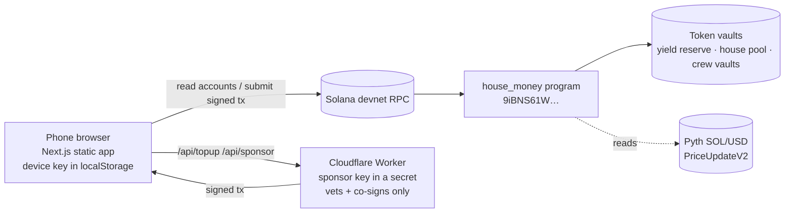
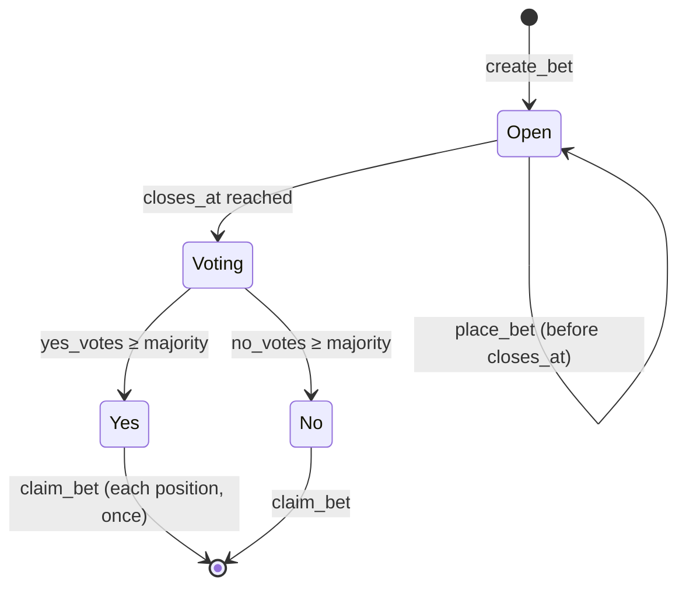

# Architecture (v2: crews, bets and challenges)

Current as of 20 Nov 2026. The first concept (Vault + weekly "Call it") is in [`architecture.md`](architecture.md); decisions and their reasons are in [`decisions.md`](decisions.md).

## Containers

- The app never shows keys, SOL or fees. The device key would be a Privy embedded wallet in production.
- The Worker has no RPC dependency: it returns signed transactions and the device submits them (D6).

## Program accounts

| Account | Seeds | Holds |
|---|---|---|
| Config | `config` | admin, mint, price feed, APY, time warp, call rules |
| Crew | `crew, creator, crew_id` | name, emoji, total shares, total principal, yield paid, members |
| Crew vault | `crew_vault, crew` | the crew's dollars (authority: the crew PDA) |
| Member | `member, crew, owner` | shares, principal (what they put in) |
| Profile | `profile, owner` | display name (≤ 24 chars) |
| Bet | `bet, crew, bet_id` | question, subject, closes_at, yes/no shares, votes, outcome |
| Position | `position, bet, owner` | side, shares locked, claimed |
| Challenge | `challenge, crew, challenge_id` | title, stake (dollars), ends_at, participants, decided, passed/failed shares |
| Entry | `entry, challenge, owner` | shares locked, pass/fail votes, status, claimed |
| Vote | `vote, target, voter` | one per voter per bet or entry |
| Yield reserve / house pool | `yield_vault` / `house_vault` | pays interest / backs the legacy tryhard calls |

## Instructions

| Group | Instruction | Who signs | Rule |
|---|---|---|---|
| Savings | `create_crew`, `join_crew` | owner (+ sponsor pays rent) | one Member per person per crew |
| | `deposit`, `withdraw` | owner | shares at the current price; accrues yield first |
| | `accrue` | anyone | pays interest due from the reserve |
| Social | `set_profile` | owner | name shown to the crew |
| | `create_bet` | a member | deadline in the future |
| | `place_bet` | a member | before the deadline; one position per person; shares ≤ member's |
| | `vote_bet` | a member, not the subject | after the deadline; strict majority of eligible members settles it |
| | `claim_bet` | position owner | once; winners get stake + pro-rata of losers; refund if nobody won |
| | `create_challenge`, `join_challenge` | a member | stake in dollars converted to shares at join (rounded up) |
| | `vote_entry` | a member, not the participant | after the end; majority of members minus one |
| | `claim_challenge` | entry owner | after every entry is decided; refund if nobody passed |
| Legacy | `open_call`, `settle_call` | owner / anyone | SOL up/down on yield only, settled with Pyth (not in the app) |

## Bet lifecycle

A challenge works the same way per participant: `In` → (deadline) → `Did it` / `Didn't` by majority → `claim_challenge` once all entries are decided.

## Invariants (tested)

1. Principal of the original savings flow is protected; only yield can go to a legacy call (`PrincipalIsProtected`).
2. Shares are the only claim on a vault; value = shares × vault / total_shares.
3. Yield comes only from the reserve.
4. Every token movement is signed by a PDA.
5. **S1** Shares are conserved through stake, vote and claim (rounding dust stays locked).
6. **S2** One vote per member per bet or entry.
7. **S3** The subject can't vote on their bet; nobody judges their own entry.
8. **S4** A strict majority decides and the decision is final.
9. **S5** Nobody on the winning side, or nobody completed: everyone is refunded.

Tests: `cargo test` (8 unit tests), `scripts/e2e.mts` (15), `scripts/social-e2e.mts` (14), `scripts/worker-security.mts` (14), Solana MCP `program_autofixer` (0 issues).

## Trust model

| Party | Can | Can't |
|---|---|---|
| Member | stake, vote, withdraw their own shares | move another member's shares; vote twice; vote on themselves |
| Crew majority | decide outcomes | take shares from people who didn't stake |
| Sponsor (Worker) | pay fees and rent | appear as owner; sign foreign instructions; set fees above the cap |
| Admin | tune demo config (rate, time warp) | touch any vault (every transfer is PDA-signed) |
| Upgrade authority (sponsor key, devnet) | upgrade the program | in production: move to a multisig or freeze |
