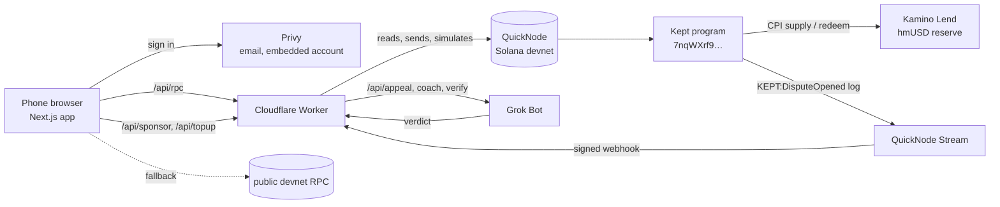

# Architecture: Kept

Current as of 20 Nov 2026 (after the audit). The idea is in [`context.md`](context.md), the product rules in
[`PRODUCT.md`](PRODUCT.md), the reasons in [`decisions.md`](decisions.md), the status of each integration in
[`integrations.md`](integrations.md).

## 1. What the user sees vs what runs underneath

| The user sees | Underneath |
|---|---|
| Sign in with email | Privy creates the person's Solana account and signs every action for them |
| Add money with Apple Pay | Simulated today: test dollars (hmUSD, an SPL token) from the sponsor. Next: Crossmint Onramp into USDC |
| Put $20 on the line | Shares of the group pot locked in the person's Entry inside the Kept program |
| Your money is safe while the pact runs | The pot is lent on Kamino Lend and earns interest; the program owns the position |
| Your friends verify | One vote per participant, recorded by the program; a strict majority of the others decides |
| Disagree with a result | `open_dispute` records it on-chain; a QuickNode Stream sends it to the Grok council for review |
| You got $32.67 back | The program pays stake + share of 95% of what was left behind; 5% to Kept, taken once |
| No fees, no SOL | A Cloudflare Worker pays every network fee |

## 2. Containers

- **Worker routes** (`worker/index.ts`, `worker/grok.ts`, `worker/quicknode.ts`): `/api/config`, `/api/rpc`
  (QuickNode proxy), `/api/sponsor` (co-sign as fee payer), `/api/topup` (simulated Apple Pay), Grok routes,
  `/api/streams/quicknode`.
- **The sponsor signs only** the app's own Kept instructions, with one compute limit ≤ 400k CU, a priority fee
  ≤ 1,000,000 µlamports/CU, never as an owner, after a passing simulation on QuickNode. Rate-limited per IP and
  account.
- **The RPC proxy** forwards an allowlist of methods, re-serialized, with timeouts; `sendTransaction` only for
  sponsor-paid transactions. The browser never sees the QuickNode token.

## 3. Program (devnet `7nqWXrf9A6WwNxDJ3x1qH6UnCJs1o7iEHtRix7mnDQt1`)

| Account | Seeds | Holds |
|---|---|---|
| Crew (the group) | `crew, creator, crew_id` | name, total shares, members, Kamino principal and cTokens |
| Crew vault | `crew_vault, crew` | the group's idle dollars (authority: the crew PDA) |
| Member | `member, crew, owner` | free shares, principal |
| Profile | `profile, owner` | display name |
| Challenge (the pact) | `challenge, crew, challenge_id` | title, minimum stake, deadline, participants, decided, passed/failed shares |
| Entry | `entry, challenge, owner` | locked shares, votes, status, claimed |
| GoalNote | `goal, entry` | the person's own goal (≤ 80 chars) |
| Vote | `vote, entry, voter` | one per voter per entry |
| Dispute | `dispute, entry` | who disputed, why; one per entry |
| FeeTaken, house vault | `fee, challenge`, `house_vault` | the 5%, moved once |
| Config | `config` | admin (= Kamino operator), mint, Kamino reserve |

**Kamino** (`kamino.rs`): `kamino_supply` (operator only; the app always supplies the whole vault) and
`kamino_redeem` (anyone) move a pot's own dollars between its vault and cTokens owned by its PDA. Shares are
never priced while money is in Kamino (`KaminoNotRedeemed`), so the app wraps every priced action as
`[refresh, redeem, action, refresh, supply(0)]`: interest lands, the action runs at the exact price, the pot goes
back to work. Amounts under $0.01 stay in the vault.

**Turned off after the audit:** yes/no bets (`create_bet`) and the SOL up/down calls (`open_call`) return
`Disabled`. Existing bets can still be voted and claimed.

## 4. Pact lifecycle

```mermaid
stateDiagram-v2
  [*] --> Open: create pact + lock your own goal and stake
  Open --> Open: friends join with their own goal and stake
  Open --> Voting: deadline
  Voting --> Kept: strict majority of the other participants say yes
  Voting --> Missed: strict majority say no
  Voting --> Undecided: window closes (120 s on devnet)
  Undecided --> Kept: more yes than no
  Undecided --> Refunded: anything else (nobody loses without a majority)
  Kept --> Settled
  Missed --> Settled
  Refunded --> Settled
  Settled --> [*]: collect (stake + share of 95% of forfeits; 5% to Kept once; refund if nobody kept it)
```

A dispute (`open_dispute`) can be opened by any participant once the pact has ended, on any entry not yet
collected (one per entry). It is advisory: it starts the Grok review but never moves money by itself.

## 5. Invariants (tested)

1. Shares are the only claim on a pot; value = shares × assets / total shares, with a virtual offset.
2. Every token movement is signed by a PDA; no admin can move member funds out of a pot.
3. Shares can't be priced while money is in Kamino; the price after a redeem is exact.
4. One vote per voter per entry; nobody votes on themselves; only participants vote.
5. Nobody loses a stake without a strict majority of the other participants.
6. The platform takes exactly 5% of forfeits, once, only if someone kept their word; if nobody did, all refunded.

Tests: `cargo test` 12; on devnet `kept-e2e` 10/10, `kamino-e2e` 7/7, `dispute-e2e` 10/10, `app-e2e` 6/6,
`worker-security` 32/32 (see `audit-2026-11-20.md`).

## 6. Trust model

| Party | Can | Can't |
|---|---|---|
| Participant | stake, vote on others, dispute, withdraw free money | vote on themselves or twice, move others' money |
| Group (participants) | decide each result by strict majority | take money without a majority |
| Grok council | review disputes and goals, advise | move money (verdicts are advisory) |
| Platform | receive 5% of forfeits | take stakes of people who kept their word |
| Sponsor (fee payer, Kamino operator) | pay fees and rent; move a pot's whole vault into its own Kamino position | act as an owner, sign foreign instructions, exceed the fee cap |
| Kamino market owner (devnet: the team) | change the reserve | — trust assumption; mainnet uses Kamino's main market |
| Upgrade authority (devnet) | upgrade the program | production: multisig or freeze |
