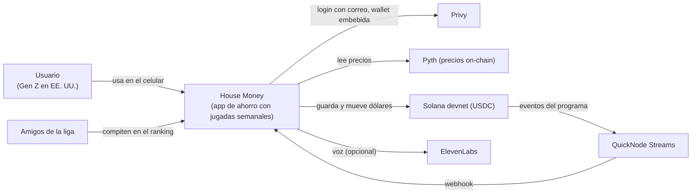
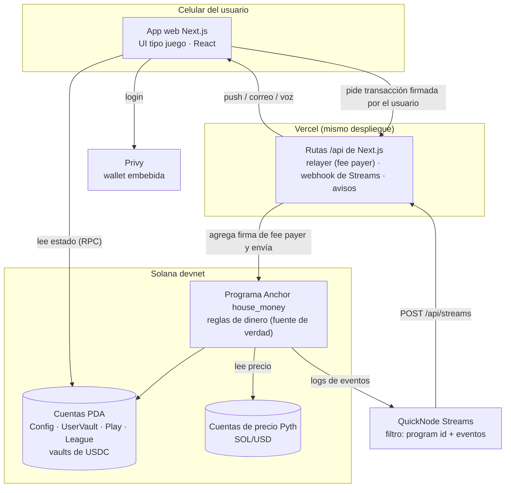
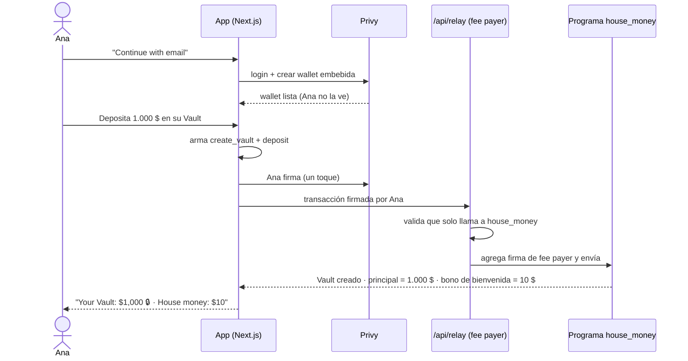
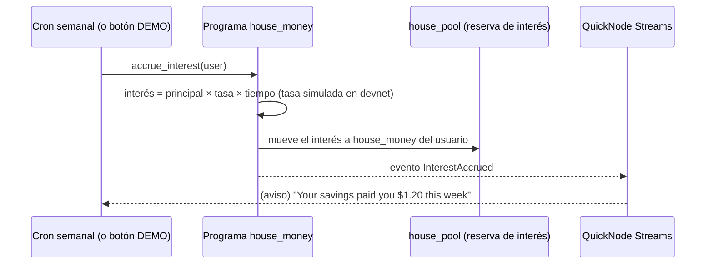
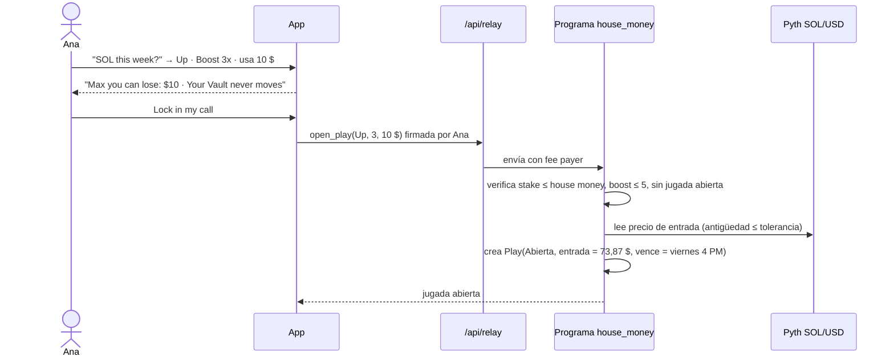
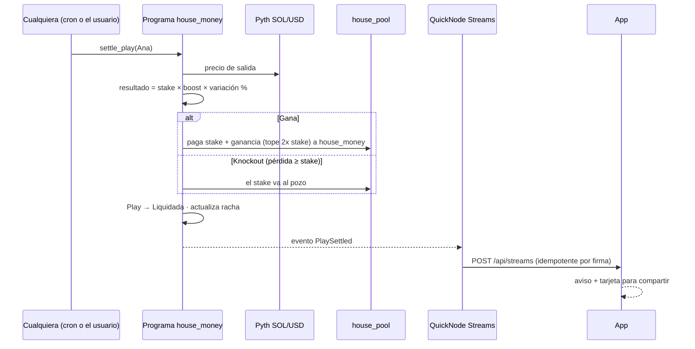
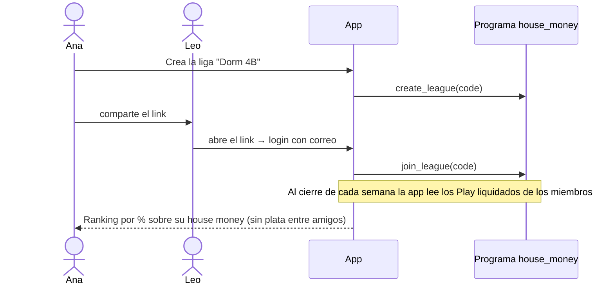

# House Money: arquitectura y flujos

17/11/2026. Hecho con la skill `arquitectura-de-software`: primero el diagnóstico, después el estilo; luego C4 por niveles y los patrones con sus 4 elementos (nombre, problema, solución, consecuencias).

## 1. Diagnóstico (antes de elegir patrones)

| Pregunta | Respuesta |
|---|---|
| ¿Qué es lo que **no puede fallar**? | La promesa "tu ahorro nunca se mueve". Tiene que ser una **regla del programa on-chain**, no del frontend ni del backend |
| ¿Qué cambia seguido? | La UI, los textos, los mercados disponibles, la fuente de precio (Pyth real vs. modo demo), los avisos |
| ¿Qué es estable? | Las reglas de dinero: depositar, separar interés, jugar con tope, liquidar, retirar |
| Equipo y plazo | 3-4 personas, 2,5 días |
| ¿Necesita microservicios o eventos? | **No.** La skill es explícita: con equipo chico y un solo despliegue, **monolito modular**. Los eventos solo aparecen en el borde (avisos), donde la consistencia eventual no importa |

**Decisión de estilo:** arquitectura en **capas** con dos niveles (cliente-servidor), más un programa on-chain que es la **única fuente de verdad del dinero**.

| Capa | Dónde vive | Responsabilidad |
|---|---|---|
| Presentación | Next.js (pantallas) | UI tipo juego, sin lógica de dinero |
| Aplicación | Next.js (`lib/house-money` + rutas `/api`) | Arma transacciones, paga el gas (relayer), recibe eventos |
| Dominio (reglas de dinero) | Programa Anchor `house_money` | Invariantes del Vault, jugadas, liquidación |
| Datos | Cuentas de Solana (PDAs) + Pyth | Estado y precios |

## 2. C4, nivel 1: contexto

## 3. C4, nivel 2: contenedores

## 4. C4, nivel 3: componentes del programa on-chain

| Cuenta (PDA) | Semillas | Qué guarda | Experto GRASP de… |
|---|---|---|---|
| `Config` | `["config"]` | admin, mint de USDC, tope de boost (5), tope de ganancia (2x), tolerancia de precio, modo demo | Parámetros del juego |
| `UserVault` | `["vault", user]` | `principal`, `house_money`, `last_accrual_ts`, `streak`, `open_play` | **Cuánto puede jugar el usuario** (tiene la información) |
| `Play` | `["play", user, week]` | dirección, boost, monto, precio de entrada, vence, estado | Su propio resultado |
| `League` | `["league", code]` | hasta 8 miembros, semana actual | El ranking |
| `vault_usdc` | token account del programa | El dinero de todos los Vaults | — |
| `house_pool` | token account del programa | Contraparte de las jugadas y reserva para el interés de la demo | — |

**Instrucciones:** `init_config`, `create_vault`, `deposit`, `withdraw_principal`, `accrue_interest`, `open_play`, `settle_play`, `create_league`, `join_league`.

### Invariantes (lo que se prueba con tests y se cuenta a los jueces)

1. `principal` solo baja con `withdraw_principal`, y solo hacia la wallet del dueño.
2. `open_play.stake ≤ house_money`. **No existe ninguna instrucción que pase dinero del principal al house money.**
3. **No se puede depositar directo en `house_money`**: solo lo llena `accrue_interest` (y el bono de bienvenida).
4. `boost ≤ Config.max_boost` (5) y una sola jugada abierta por usuario.
5. Ganancia máxima por jugada = `stake × Config.max_win_multiple` (2x), para que el pozo de la casa no se vacíe.
6. `settle_play` usa el precio de Pyth con antigüedad ≤ `Config.max_price_age`; si no hay precio válido, la jugada se devuelve sin ganar ni perder.

## 5. Patrones elegidos (los 4 elementos)

| Patrón | Problema | Solución | Consecuencias |
|---|---|---|---|
| **State** (GoF) | Una jugada se comporta distinto según su momento (abierta, ganada, knockout, devuelta); con banderas sueltas habría combinaciones inválidas | `PlayState` como enum con transiciones explícitas validadas en el programa (`Open → Won / Knockout / Refunded → Settled`) | + Imposible liquidar dos veces o liquidar una jugada cerrada. − Cada estado nuevo exige tocar el `match` (aceptable: son pocos) |
| **Strategy** (GoF) para la fuente de precio | En devnet Pyth se actualiza poco y la demo necesita "avanzar el tiempo" sin mentir | Interfaz `PriceSource` en el programa: `PythSource` (real) y `DemoSource` (solo si `Config.demo_mode` y firmado por el admin; la UI lo etiqueta "DEMO") | + Demo fiable y honesta; en mainnet `demo_mode` queda apagado por configuración. − Hay que asegurarse de que `DemoSource` no exista fuera de devnet |
| **Facade** (GoF) + **Indirección** (GRASP) | La UI no debe conocer Anchor, PDAs ni firmas; si cambia el programa, se romperían todas las pantallas | `lib/house-money/client.ts` expone `deposit()`, `callIt()`, `settle()`, `getHome()`; las pantallas solo hablan con esa fachada | + Bajo acoplamiento: se puede desarrollar el frontend con datos simulados hoy y conectar el programa mañana. − Una capa más que mantener |
| **Adapter** (GoF) | Privy (wallet embebida) y el relayer tienen interfaces distintas a la de Anchor | `PrivySignerAdapter` adapta la wallet de Privy a `Signer`; `RelayerAdapter` agrega la firma del fee payer | + Cambiar de Privy a otra wallet toca un solo archivo |
| **Controlador** (GRASP) | ¿Quién recibe la petición de "paga mi gas" y decide si la acepta? | Ruta `/api/relay` como controlador: valida que la transacción solo llame a `house_money` y la reenvía | + Evita que alguien use nuestro fee payer para otra cosa (seguridad) |
| **Observer** + **Idempotent Consumer** | Los avisos ("Ana ya jugó", "knockout") dependen de lo que pase on-chain | QuickNode Streams observa el programa → `POST /api/streams` → avisos. La firma de la transacción es la clave de idempotencia | + Desacoplado del flujo principal; si falla un aviso, el dinero no se entera. − Consistencia eventual (aceptable para avisos) |

**Anti-patrones que evitamos** (según `anti_patrones.md`):
- **God Object:** no hay una instrucción "hacer todo"; una por acción.
- **Dual Write:** el backend no guarda saldos propios. El dinero vive solo on-chain y la UI lee de ahí.
- **Golden Hammer:** no metemos microservicios ni base de datos si no hacen falta.

## 6. Máquina de estados de una jugada

```mermaid
stateDiagram-v2
    [*] --> Abierta: open_play (stake ≤ house money, boost ≤ 5)
    Abierta --> Ganada: settle_play · precio a favor
    Abierta --> Knockout: settle_play · pérdida ≥ stake
    Abierta --> Perdida: settle_play · precio en contra, pérdida < stake
    Abierta --> Devuelta: settle_play · sin precio válido
    Ganada --> Liquidada: paga stake + ganancia (tope 2x) desde el pozo
    Perdida --> Liquidada: devuelve lo que queda; el resto va al pozo
    Knockout --> Liquidada: el stake entero va al pozo
    Devuelta --> Liquidada: devuelve el stake
    Liquidada --> [*]
```

## 7. Flujos (secuencia)

### 7.1 Registro y primer depósito

### 7.2 Interés semanal (house money)

### 7.3 Call it: abrir la jugada

### 7.4 Viernes: liquidar (gana o knockout)

### 7.5 Liga semanal

## 8. Plan de construcción en 2,5 días (por capas, en paralelo)

| Bloque | Quién | Depende de |
|---|---|---|
| Frontend con datos simulados detrás de la fachada `client.ts` | 1 persona | Nada (empieza hoy) |
| Programa Anchor + tests de las 6 invariantes | 1-2 personas | Nada |
| Relayer `/api/relay` + Privy | 1 persona | La fachada |
| QuickNode Streams + `/api/streams` | 1 persona | El programa desplegado |
| Conectar la fachada al programa real | Todos | Todo lo anterior |

La fachada es la que permite trabajar en paralelo: el frontend no espera al programa.
