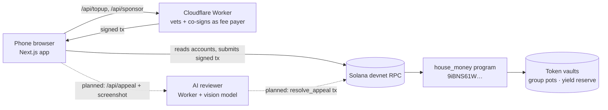

# Architecture: Kept

Current as of 20 Nov 2026. The product idea is in [`context.md`](context.md); the reasons behind each choice are in [`decisions.md`](decisions.md).

This document has two parts: what the code does **today**, and what changes to match the chosen idea. Every row in §5 says whether it is built.

## 1. What the user sees vs what runs underneath

| The user sees | Underneath |
|---|---|
| Sign in with email | A key created on the device (production: Privy embedded wallet) |
| "Add money with Apple Pay" | Test dollars (hmUSD, SPL token) sent to the user's account by the app (production: Coinbase Onramp or MoonPay into USDC) |
| "Put $20 on the line" | Shares of the group pot locked in a commitment account inside a Solana program |
| "Your friends verify" | One vote per participant, recorded by the program; a strict majority decides |
| "Appeal with a screenshot" | An AI review whose decision the program records (planned, §5) |
| "You got $27 back" | The program moves shares to the people who did it; no one signs a payout by hand |
| No fees, no SOL | The app sponsors every network fee |

## 2. Containers

- The Worker only signs; the phone submits (public devnet RPCs block datacenter IPs).
- The Worker co-signs only our program's instructions, never as an owner, and caps priority fees.

## 3. Program today (deployed on devnet)

| Account | Seeds | Holds |
|---|---|---|
| Crew (the friend group) | `crew, creator, crew_id` | name, emoji, total shares, total principal, members |
| Crew vault | `crew_vault, crew` | the group's dollars (authority: the crew PDA) |
| Member | `member, crew, owner` | shares, principal |
| Profile | `profile, owner` | display name |
| Challenge (the commitment) | `challenge, crew, challenge_id` | title, stake, deadline, participants, decided, passed/failed shares |
| Entry (one person's stake) | `entry, challenge, owner` | locked shares, pass/fail votes, status, claimed |
| Vote | `vote, entry, voter` | one per voter per entry |
| Config, yield reserve | `config`, `yield_vault` | rate, demo time warp; interest source |

Also in the program, not part of this product: `Bet`/`Position` (yes/no bets on events) and the legacy SOL up/down calls. They pass their tests but are hidden from the pitch (see D13).

Flow today: create the commitment (title, stake, deadline) → friends `join_challenge` (same stake each) → after the deadline any **crew member** except the person votes `Did it / Didn't` → strict majority decides → once every entry is decided, each claims: those who did it get their stake plus a pro-rata share of **100%** of the forfeits; if nobody did it, everyone is refunded.

## 4. Commitment lifecycle (target)

```mermaid
stateDiagram-v2
  [*] --> Open: create commitment
  Open --> Open: friend joins with own goal + stake
  Open --> Verifying: deadline
  Verifying --> Did: majority of other participants say yes
  Verifying --> Failed: majority say no
  Failed --> Appealed: owner uploads proof (within window)
  Appealed --> Did: AI accepts proof
  Appealed --> Failed: AI rejects proof
  Did --> Settled
  Failed --> Settled: appeal window closes
  Settled --> [*]: claim (stake + 95% of forfeits pro rata; 5% to platform via take_fee)
```

## 5. Status of each piece

| # | Change | Program | App | Status |
|---|---|---|---|---|
| 1 | Each person states **their own goal** and **their own stake** when joining | `join_with_goal(goal, stake)`; goal stored in a `GoalNote` PDA (≤ 80 chars); stake ≥ the pact's minimum | goal and amount in the lock sheet | **Built** |
| 2 | **Only people who put money in confirm** | `vote_entry` takes the voter's own Entry (seeds `entry, challenge, voter`); majority of the other participants | confirm buttons only for participants | **Built** |
| 3 | **Forfeits: 95% to those who kept their word, 5% to the platform** | `PLATFORM_FEE_BPS = 500`; `take_fee` moves the 5% to the config-owned treasury once (`FeeTaken` PDA); `claim_challenge` pays stake + pro-rata share of 95% | result card shows the split; the first collect also takes the fee | **Built** |
| 4 | **Appeal with proof, reviewed by AI, recorded on-chain** | `appeal(evidence_hash)` by the person within a window; `resolve_appeal(accepted)` signed only by the configured arbiter key; event with the decision | upload screenshot; show "AI reviewed: accepted / rejected" | To build (AI review simulated in the demo, per the team's plan) |
| 5 | Claims wait until appeals close | `claim` requires all entries settled and no open appeals | — | To build |
| 6 | **Hide yes/no bets** in the app | — | removed | **Built** |
| 7 | Email login | — | Privy embedded wallet | Not in the hackathon build |
| 8 | Automatic proof (Strava, Screen Time, Apple Health) | — | integrations | Next |
| 9 | Locked deposits earn | already: stakes are pot shares, so they keep earning while locked | show "earning while on the line" | Built |
| 10 | Sponsored fees, Apple Pay (simulated), invite links, names | — | — | Built |

## 6. Invariants

Tested today (`cargo test` 8, `scripts/e2e.mts` 15, `scripts/social-e2e.mts` 14, Solana MCP `program_autofixer` 0 issues):

1. Shares are the only claim on a pot; value = shares × vault / total_shares (virtual offset against inflation).
2. Every token movement is signed by a PDA; no admin can move member funds.
3. Shares are conserved through stake, vote and claim (rounding dust stays locked).
4. One vote per voter per entry; nobody votes on their own entry; a strict majority is final.
5. If nobody completed, everyone is refunded.

Added and tested (`kept-e2e.mts` 9/9): only participants vote; the platform cut is exactly 5% of the forfeits, only if someone kept their word, taken once. Still to add: only the arbiter key can resolve an appeal, once, for an entry marked failed that appealed in time; a default outcome when nobody confirms.

## 7. Trust model

| Party | Can | Can't |
|---|---|---|
| Participant | stake, vote on others, appeal their own result, withdraw unlocked money | vote on themselves, vote twice, move others' money |
| Group majority (participants) | decide each result | take money from people who didn't stake |
| AI arbiter (planned) | accept or reject one appeal | touch funds directly; overrule a "did it" result |
| Platform | receive its fee share of forfeits | take stakes of people who did it; hold deposits outside the program |
| Sponsor (fee payer) | pay network fees and rent | appear as owner, sign foreign instructions, exceed the fee cap |
| Upgrade authority (devnet) | upgrade the program | in production: multisig or freeze |
